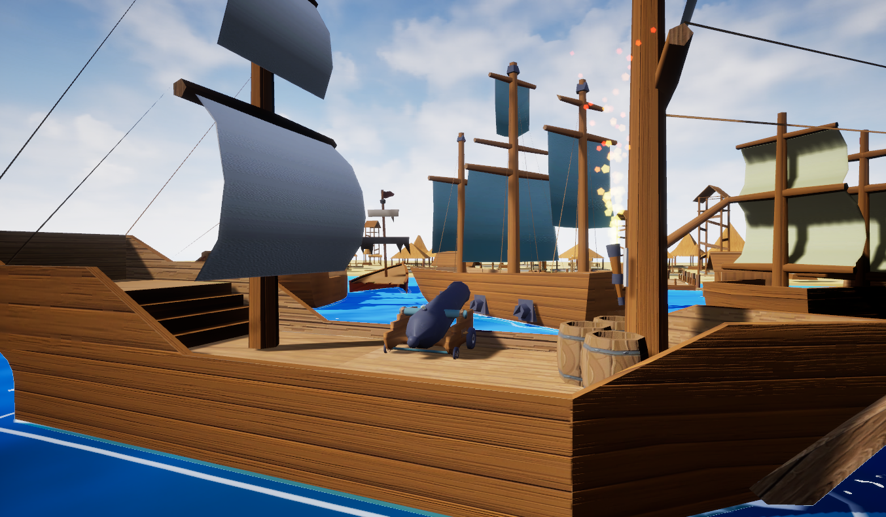

#  Minijuego batalla naval — Tutorial VR
>Para probar y utilizar este proyecto sin necesidad de gafas de Realidad Virtual físicas, es obligatorio ejecutar el archivo `LanzarConSimulador.bat` incluido en la carpeta

 

##  1. Ficha de Diseño de la Mecánica

| Campo | Descripción |
| :--- | :--- |
| **Duración estimada** | 3 a 4 minutos |
| **Público objetivo** | Usuarios noveles en VR sin conocimiento previo de los mandos ni de la interacción espacial. |
| **Acciones que enseña** | 1. Observación y orientación con la posibilidad de mirar a tu alrededor. 2. Agarre de objetos, coger la antorcha encendida de su soporte. 3. Manipulación de elementos y apuntado agarrando el cañón para rotarlo hacia los objetivos). 4. Uso de herramientas acercandr la antorcha a la mecha del cañón para disparar. |
| **Comunicación sin texto** | • **Restricción en el espacio:** El jugador aparece frente a la borda del barco con el cañón y la antorcha a su alcance. • **Affordances visuales:** La antorcha emite luz, humo y chispas que atraen la mirada hacia el primer objeto interactuable; el cañón cuenta con una mecha en la parte trasera. • **Prevención de bloqueos:** Si la antorcha cae al suelo de cubierta, regresa automáticamente a su soporte tras 2 segundos; si cae al agua, reaparece al instante en su posición inicial. • **Ayuda progresiva:** Si tras 25 segundos el usuario no ha completado el primer disparo, se activa una luz sobre la antorcha y la mecha del cañón. |
| **Feedback inmediato y recompensas** | • **Al encender la mecha:** Se emite un sonido de chisporroteo continuo, activación de partículas en la mecha. • **Al disparar:** Hay una explosión sonora de cañonazo, una vibración háptica y lanzamiento físico de la bala. • **Recompensa final:** El barco se hunde fisicamente bajo el agua. |

 

## 2. Tabla de Controles

| Acción en el juego | Interacción física en VR | Botón / Control del mando |
| :--- | :--- | :--- |
| **Mirar alrededor** | Movimiento con el ratón | Visor de las gafas |
| **Desplazarse por el barco** | WASD para moverse | Movimiento con los joysticks de los mandos - *No probado* |
| **Agarrar la antorcha** | Doble click al botón central del ratón `mouse 3` | Gatillo lateral (**Grip** — `L` / `R`) - *No probado* |
| **Soltar la antorcha** | Doble click al botón central del ratón `mouse 3` | Gatillo lateral (**Grip** — `L` / `R`) - *No probado* |
| **Apuntar el cañón** | Doble click al botón central del ratón `mouse 3` para agarrar el cañon | Gatillo lateral (**Grip** — `L` / `R`) - *No probado* |
| **Encender mecha y disparar** | Acercar la punta encendida de la antorcha a la mecha trasera del cañón | Acercar la punta encendida de la antorcha a la mecha trasera del cañón |

 

## 3. Créditos de Modelos 3D y Recursos Externos

Todos los recursos externos empleados proceden de bibliotecas gratuitas y cuentan con licencia libre para uso académico y desarrollo en Unreal Engine:

| Recurso / Asset | Fuente |
| :--- | :--- |
| **Modelo de Cañón**| https://sketchfab.com/3d-models/low-poly-cannon-6099c62ef44e4e67b682971f042a8ee9 |
| **Pack barcos**| https://sketchfab.com/3d-models/stylized-pirate-island-pack-low-poly-3d-assets-77d8d91e3fb14ef289850bc59d8683d6 |
| **Antorcha**| https://sketchfab.com/3d-models/low-poly-torches-06fa08b3b2834d26b3deee112eda2919 |

 

